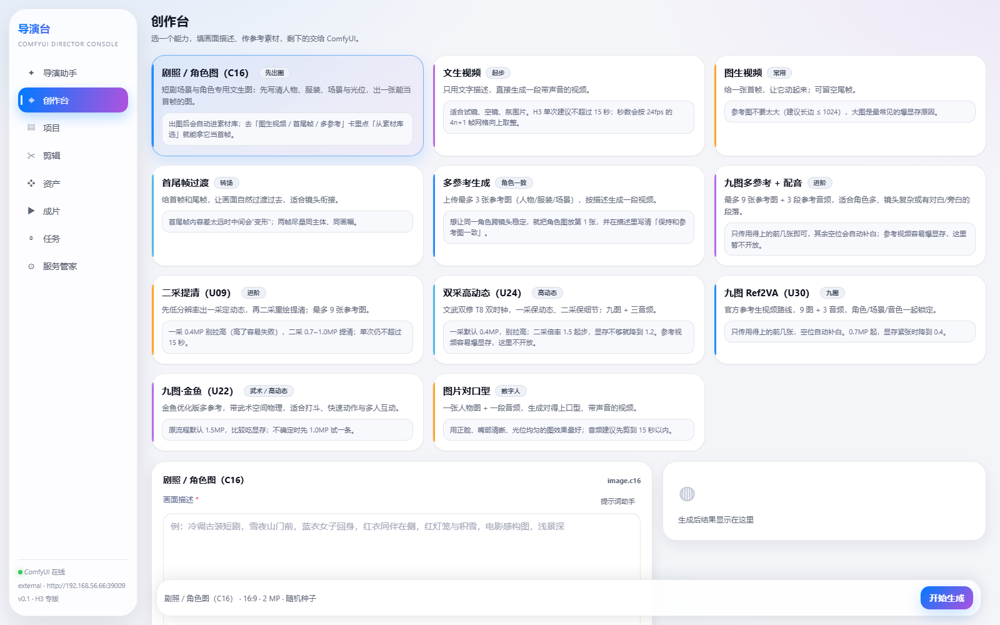
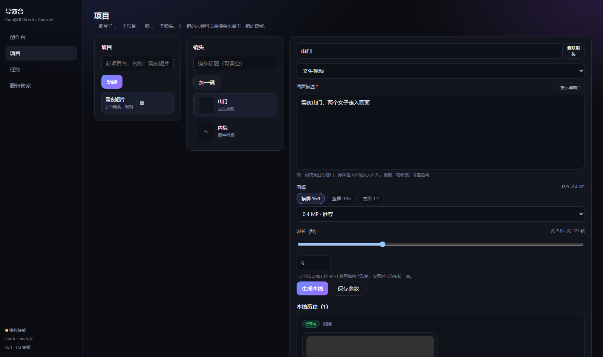
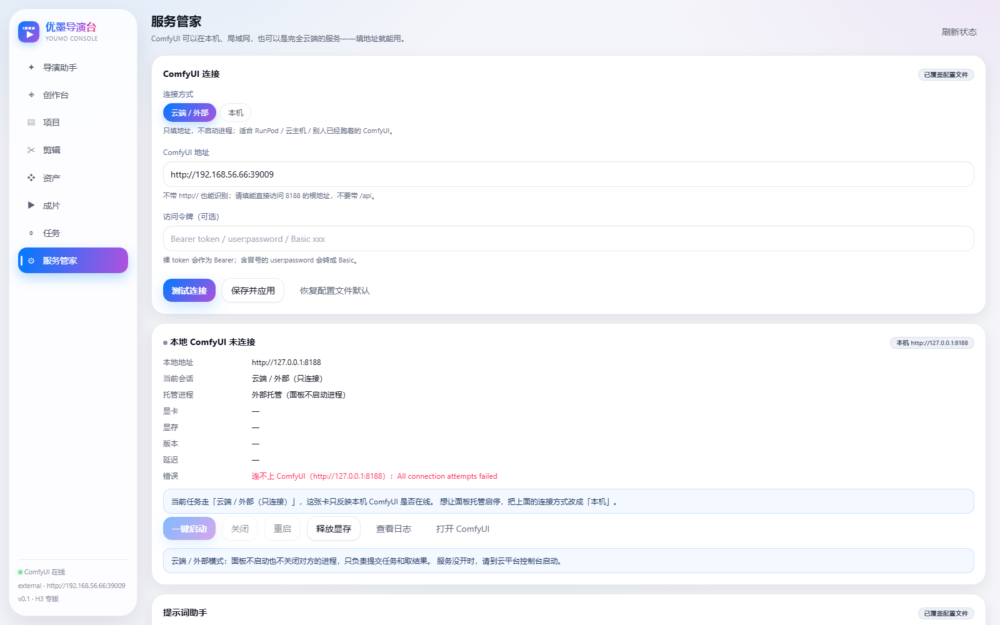
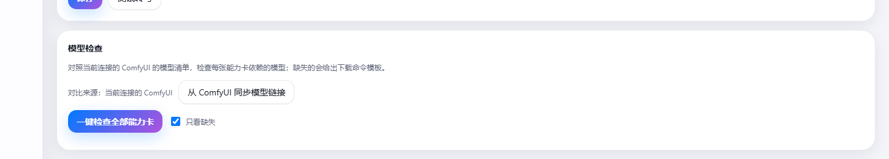
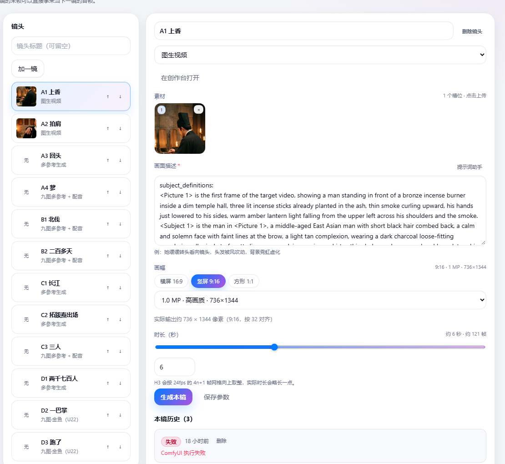
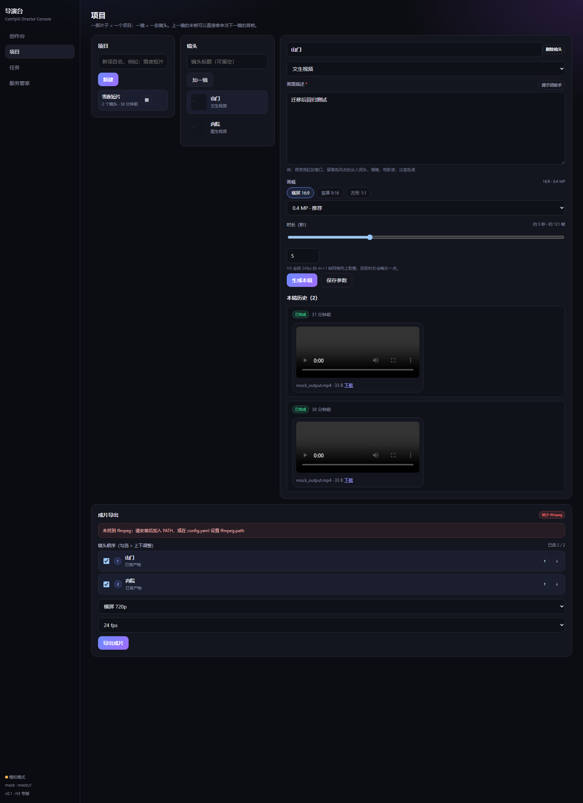
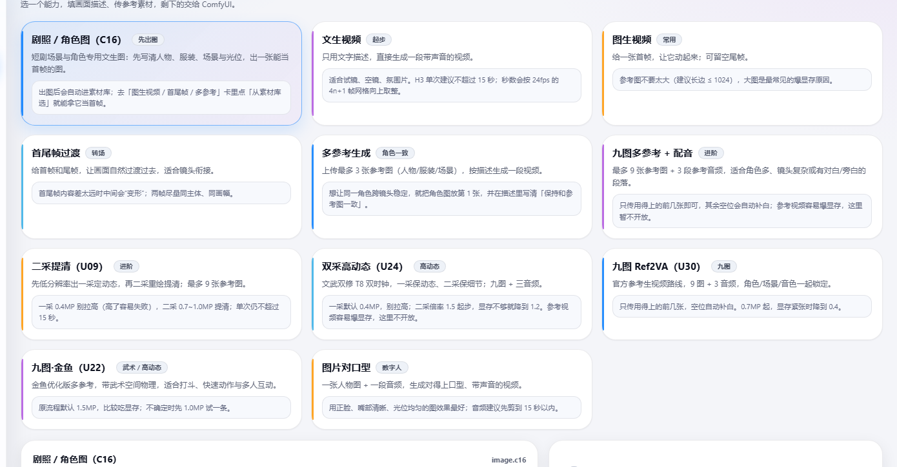

# ComfyUI 导演台

面向内容创作者的 AI 视频工作台：**选一个能力 → 传素材、写描述 → 出片**。
底层仍然是 ComfyUI 在工作流里跑，但创作者永远不需要看到节点。

- 后端：Python 3.11 + FastAPI（`backend/`）
- 前端：React 18 + TypeScript + Vite（`web/`）
- 工作流：47 套 `API-*.json` 全部入库，其中 11 套已配成能力卡（H3 全系）
- 数据：SQLite（`data/director.db`）+ 本地文件（`data/uploads`、`data/outputs`）







## 云端 ComfyUI（推荐）

ComfyUI 不必在本机。打开「服务管家 → ComfyUI 连接」：

1. 连接方式选 **云端 / 外部**（不启动进程）；
2. 填地址，例如 `https://xxxx-8188.proxy.runpod.net`（不带 `http://` 也能识别，不要带 `/api`）；
3. 有鉴权就填令牌（裸 token 当 `Bearer`，`user:password` 自动转 `Basic`）；
4. 点 **测试连接**，看到 GPU/版本/延迟就说明通了；
5. **保存并应用**，立即生效并写入 SQLite，重启后仍然有效。

对应接口：

```bash
GET    /api/settings/comfy        # 当前生效的连接
PUT    /api/settings/comfy        # {mode, base_url, token}
POST   /api/settings/comfy/test   # {base_url, token} 只测试不保存
DELETE /api/settings/comfy        # 回到 config.yaml 默认
```

优先级：**页面里保存的值 > config.yaml > 内置默认**。想回到配置文件，点「恢复配置文件默认」。

> 如果云端地址要走公司代理，把 `config.yaml` 的 `comfy.trust_env` 改成 `true`；
> 本机/局域网直连建议保持 `false`（默认），避免系统代理配置异常导致连不上。

### 没有云端也能先跑通：本地假服务

```bash
python tools/stub_comfy.py --port 8199 --token secret123
```

然后在页面里连 `http://127.0.0.1:8199`、令牌 `secret123`，整条链路（上传/提交/轮询/下载）
都会走真实 HTTP，只是产物是占位文件。用来验证远程接入、鉴权、失败重试很方便。

## 路线图

- [x] M0 服务管家：一键启停 / 状态 / 日志 / 释放显存
- [x] M1 单镜生成：6 张能力卡 + 上传 + 任务队列 + 产物预览
- [x] M1.5 能力卡扩充到 11 张（新增 U00 提示词台 / U09 二采 / U24 双采 / U30 / U22）
- [x] M2 项目与分镜：项目 → 镜头表 → 镜间资产复用（末帧接首帧）
- [x] M2.5 云端 ComfyUI：页面填地址/令牌，测试连接 + 持久化
- [x] M3 成片：镜头勾选排序、逐段标准化、拼接、抽封面（需要本机有 ffmpeg）
- [ ] M4 真实环境联调：local / ssh 模式接上 GPU 机

## 提示词助手（可选）

在 `config.local.yaml` 里放密钥（**该文件已 gitignore，不会提交**）：

```yaml
ai:
  api_key: "sk-..."
  proxy: "http://10.0.0.1:8080"   # 只有需要走公司代理时才填
```

`config.yaml` 里配接口与模型：

```yaml
ai:
  base_url: https://www.autodl.art/api/v1
  api_key: ""
  model: "DeepSeek-V4.1-Flash"
  trust_env: false   # 只有想直接用系统 HTTP_PROXY 时才改 true
```

- 改完**保存即生效**：后端按文件修改时间自动重载 `config.yaml` / `config.local.yaml`，不用重启；
- 生成过程走 **SSE 流式返回**，界面实时显示，结束自动填进描述框
- 模型返回的是 JSON，前端会转成 H3 习惯的六段式文本
  （`subject_definitions` / `summary` / `retention_analysis` / `detailed_description` / `overall_soundscape` / `non_diegetic_music`）再填进描述框；
- 没配 key 时按钮仍可点，会提示去哪里配。

## 模型检查

「服务管家 → 模型检查」可以一键检查所有能力卡依赖的模型是否存在于当前连接的 ComfyUI：

- 后端读取每张卡的工作流，抽出 `unet_name` / `clip_name` / `vae_name` / `lora_name` 等字段里的模型文件；
- 调 ComfyUI `/object_info` 拿实际可用模型清单，按“相对路径或文件名”比对；
- 缺失的列出文件名、所在目录类别、可复制的下载命令，以及 HuggingFace 搜索链接。

命令模板来自配置：

```yaml
models:
  comfy_root: "ComfyUI"          # 下载命令里的目标根目录
  download_base: ""              # 例如 https://hf-mirror.com/your/repo/resolve/main
```

`download_base` 为空时命令里是 `"<下载地址>"` 占位；填了就拼成
`<base>/<category>/<filename>`。

> `mock` 模式没有真实模型清单，检查会直接提示“请配置真实 ComfyUI 地址”。



### 随包模型清单

从靶机（全量 ComfyUI）同步后，导出两份随仓库发版的文件：

- `content/model-sources.json`：文件名 → 下载地址（含目录），部署时直接可用；
- `content/model-manifest.json`：能力卡依赖的 36 个模型，带 url / 分类 / 引用卡片。

运行时会**合并** `content/model-sources.json` 与 `data/model-sources.json`（后者是
面板里同步得到的，优先级更高）。所以新部署不需要再连靶机。

> 当前 36 个依赖里 28 个已解析到公开地址（均已 HEAD 校验 200）；
> 剩余 8 个是私有/社区改名权重，检查面板里会标为未解析，可按需手工补进
> `content/model-sources.json`。

### 真实下载链接来自 UI 工作流

ComfyUI 面板的「缺失模型 → 下载」按钮，读的是 **UI 工作流 JSON 里节点的
`properties.models`**（`name` / `url` / `directory` / `hash`），并且只对
`civitai.com`、`huggingface.co` 白名单地址展示下载按钮。API 格式工作流没有
`properties`，所以只有 UI workflow 才带仓库信息。

导演台的做法：

1. 连上装有这些工作流的 ComfyUI，点 **「从 ComfyUI 同步模型链接」**：
   后端会从 `/userdata?dir=workflows` 拉取所有 UI 工作流，解析 `properties.models`，
   存到 `data/model-sources.json`（文件名 → 下载地址 / 目录）；
2. 之后再跑模型检查，缺失模型如果命中映射，会直接给出**真实地址**的下载命令，
   并在条目上标「链接来自工作流」；
3. 也可以手动导入：`POST /api/models/sources/import`，body 传单个 UI workflow、
   数组或 `{workflows:[...]}`。

注意：ComfyUI 自身的模型清单接口是 `/experiment/models`（旧代码曾误写为 `/models`），
现已修正。

## 创作台 ↔ 项目

两边现在互通了：

- **创作台 → 保存为镜头**：试出满意的一条后，点当前任务下方的「保存为镜头…」，
  选项目、填标题即可。会把 `preset_id + 全部参数` 写成新镜头，把这次 job 归属回填，
  并自动抽末帧挂到该镜头（所以下一镜能直接用它当首帧）。
- **项目 → 在创作台打开**：镜头编辑器里点「在创作台打开」，会把该镜头的参数带进创作台，
  顶部出现提示条；改完点「保存回该镜头」覆盖，或「返回项目」放弃。

对应接口：

```bash
POST /api/jobs/{job_id}/save-as-shot   # {project_id, title}
GET  /api/shots/{shot_id}              # 带 values / last_frame_url
```



## 成片导出（M3）

「项目」页底部就是成片面板：

1. 勾选要合成的镜头（默认全选），用 ↑ ↓ 调整顺序；
2. 选分辨率（横屏/竖屏 720p、1080p）与帧率（24/30）；
3. 点「导出成片」，后台会逐段标准化 → 拼接 → 抽封面，完成后可预览/下载/删除。

实现方式：

- 每段先统一成相同分辨率、帧率、采样率（等比缩放 + 补边，不拉伸），再走 concat demuxer，避免音画不同步；
- 没有音轨的片段自动补一段等长静音，保证每个输入都有音频；
- 产物落在 `data/renders/<id>/final.mp4`，封面 `cover.jpg`，通过 `/media/files/` 访问；
- 任务表 `renders` 由 Alembic `0004_renders` 管理，服务重启会把中断的导出标为失败。

**ffmpeg 是硬依赖**：

```yaml
ffmpeg:
  path: ""        # 留空自动找 PATH；也可以写 D:/tools/ffmpeg/bin/ffmpeg.exe
  crf: "20"
  preset: "medium"
```

没装时页面会显示「缺少 ffmpeg」，导出接口返回 400 并给出提示，不会产生半成品。



## 项目 / 分镜怎么用

1. 「项目」页新建一部片子（例如 `雪夜短片`）。
2. 「加一镜」，选能力卡、填描述、传参考图，点「生成本镜」。
3. 生成成功后，后端会把这条片子的**末帧**抽出来存成素材；下一镜在编辑器顶部点
   **用上一镜末帧**，它就变成了下一镜的首帧（选「图生视频 / 首尾帧」卡时出现）。
4. 每个镜头保留最近 12 次尝试，可回看、可对比。

> 末帧抽取依赖 **ffmpeg**。没装时不会报错，会写入一张「末帧占位」图并在按钮上标「（占位）」，
> 装上 ffmpeg 后自动变成真实末帧。

## 快速开始

### 1. 后端

默认使用**系统 Python**（当前开发环境为 `D:\Python\Python311\python.exe`，3.11.9）：

```bash
cd backend
python -m pip install -r requirements.txt
python -m uvicorn app.main:app --host 127.0.0.1 --port 6006
```

Windows 也可以直接双击根目录的 `start.bat`；Linux 用 `bash start.sh`。
两个脚本都调用 PATH 里的 `python` / `python3`，也可以用环境变量 `PYTHON` 指定解释器。

> 想用独立虚拟环境：`python -m venv backend/.venv` 后装依赖，再用
> `PYTHON=backend/.venv/Scripts/python.exe` 启动 `start.bat`。
> 仓库里可能残留一个只有 pip 的空 `backend/.venv`，不用时可直接删掉。

### 2. 前端

```bash
cd web
npm install
npm run dev      # 开发模式，http://127.0.0.1:5273（已代理 /api 到 6006）
npm run build    # 生产模式，构建后由后端在 6006 直接托管
```

### 3. 配置 ComfyUI

编辑根目录 `config.yaml`：

```yaml
comfy:
  mode: mock     # 先看界面：mock 不需要显卡
  # mode: local  # 本机一键启停
  # mode: ssh    # 远程 Linux 机一键启停
```

| 模式 | 说明 |
|---|---|
| `mock` | 假装有 ComfyUI，3 秒返回占位产物，用来验证整条链路和界面 |
| `local` | 本机 spawn 子进程；`workdir` 指向 ComfyUI 目录，`python` 指向解释器 |
| `ssh` | 远程机执行 `start` / `stop` 命令，健康检查走 `base_url`（需先打通隧道） |
| `external` | ComfyUI 已由别人托管，只做健康检查与提交 |

本机示例：

```yaml
comfy:
  mode: local
  base_url: http://127.0.0.1:8188
  local:
    workdir: D:/ComfyUI_windows_portable/ComfyUI
    python: D:/ComfyUI_windows_portable/python_embeded/python.exe
    args: ["main.py", "--listen", "127.0.0.1", "--port", "8188"]
```

## 现在能做什么

- **服务管家**：一键启动 / 关闭 / 重启 / 释放显存 / 看日志 / 自动健康检查
- **创作台**：11 张能力卡
  | 卡片 | 工作流 | 说明 |
  |---|---|---|
  | 剧照 / 角色图 | C16 | 先出角色/场景图 |
  | 文生视频 | U03 加速 | 只用文字 |
  | 提示词台 | U00 | 只出六段式文本 |
  | 图生视频 | U02 | 一张首帧 |
  | 首尾帧过渡 | U02 | 首帧 + 尾帧 |
  | 多参考生成 | U01 | 最多 3 图 |
  | 九图多参考 + 配音 | U06V9 | 9 图 + 3 音频 |
  | 二采提清 | U09 | 一采草稿 + 二采提清 |
  | 双采高动态 | U24 | T8 双时钟，武术/打斗 |
  | 九图 Ref2VA | U30 | 官方参考路线 |
  | 九图·金鱼 | U22 | 武术空间物理 |
  | 图片对口型 | U11 | 图 + 音频 |

  图片产物会自动进素材库：出完图后到图生视频/首尾帧/多参考卡里点「从素材库选」，
  就能把这张图当首帧/参考图。

  

  表单只暴露创作者关心的字段：描述、画幅、时长、素材
- **任务**：排队、进度、取消、重试、产物预览与下载；支持视频/图片/音频/纯文本四类产物
- **提示词助手**：复用镜像的 4 套 H3 系统提示，把一句话扩写成六段式分镜词
  （需要 `ai.api_key`，OpenAI 兼容接口）

## 数据库与迁移（Alembic）

表结构由 Alembic 管理，**不再有手写 CREATE TABLE / ALTER**。

- 迁移脚本：`backend/alembic/versions/`
- 应用启动时自动执行 `upgrade head`（`app/migrate.py`）
- 老库兼容：检测到业务表但没有 `alembic_version` 时，先按现有列判定基线 `stamp`，再升级，不丢数据
- 数据库地址：默认 `data/director.db`；可用环境变量 `DIRECTOR_DB_URL` 覆盖（如 `sqlite:///D:/tmp/test.db`）

常用命令（在 `backend/` 下）：

```bash
# 升级到最新
alembic -c alembic.ini upgrade head

# 查看当前版本 / 历史
alembic -c alembic.ini current
alembic -c alembic.ini history --verbose

# 回退一步
alembic -c alembic.ini downgrade -1

# 新增迁移（改完模型/表结构后）
alembic -c alembic.ini revision -m "add shot duration"
```

SQLite 改表必须走 batch 模式，`env.py` 已全局开启 `render_as_batch=True`，写迁移时用：

```python
with op.batch_alter_table("shots") as batch:
    batch.add_column(sa.Column("duration", sa.Float(), server_default="0"))
```

## 加一张能力卡

在 `presets/` 新建 YAML，把 ComfyUI「API 格式」工作流放到 `workflows/`：

```yaml
id: h3.my_flow
name: 我的新能力
desc: 一句话说明
workflow: API-xxx.json
order: 70
fields:
  - key: prompt
    bind: "139:prompt"        # 节点ID:字段名
    type: textarea
    label: 画面描述
    required: true
  - key: size
    type: size
    mode: wh
    width: "120:自定义宽"
    height: "120:自定义高"
```

字段类型：`text` / `textarea` / `image` / `video` / `audio` / `size` / `duration` / `number` / `select`。
`size` 支持两种模式：`wh`（直接写宽高）和 `aspect_mp`（写画幅 + 兆像素，由 ComfyUI 侧换算）。

## 目录

```
backend/app/
  main.py      FastAPI 路由
  launcher.py  服务管家（local / ssh / external / mock）
  comfy.py     ComfyUI HTTP 客户端 + mock
  ffmpeg.py    ffmpeg 探测 / 标准化 / 拼接 / 抽封面
  render.py    成片导出任务执行器
  presets.py   能力卡加载、参数注入
  jobs.py      任务执行器
  store.py     SQLite
presets/       能力卡（创作者界面）
workflows/     执行用 API 工作流（来自镜像）
content/       提示词系统、参考规范、空白占位素材
data/          SQLite / 上传 / 产物 / ComfyUI 日志
```

## 与旧面板的关系

旧 `zealman-app` 面板保持不动，作为「高级模式」：需要在画布上改节点时跳转过去。
导演台只做两件事：**管住 ComfyUI 进程**、**把工作流包装成人话界面**。

## 已知边界

- 只支持 API 格式工作流；画布里的 UI JSON 不能直接提交
- `mock` 模式产物是占位文件，不是真视频
- 单机单用户，没有账号体系；多机并发是下一阶段

## 许可证

本项目代码采用 **Apache License 2.0**，全文见 [LICENSE](LICENSE)，第三方与来源声明见 [NOTICE](NOTICE)。

需要注意：`workflows/` 与 `content/` 里的工作流、提示词、占位素材来自 Zealman ComfyUI 镜像，
**不在 Apache-2.0 授权范围内**，版权归原作者（该镜像声明「禁止基于本镜像二次开发后发布」）。
对外发布前请替换这些素材或取得授权。

## 安全提醒

- 访问令牌以明文存在本地 `data/director.db` 的 `settings` 表里，只适合单人/内网使用；
  不要把 `data/` 提交到仓库或打包分享。
- 面板默认只监听 `127.0.0.1`。要给别人用，请在前面加一层带鉴权的反向代理（Nginx/Caddy）。
