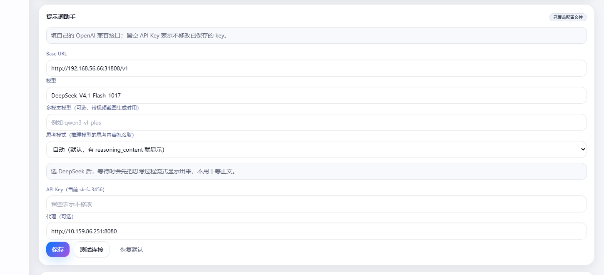
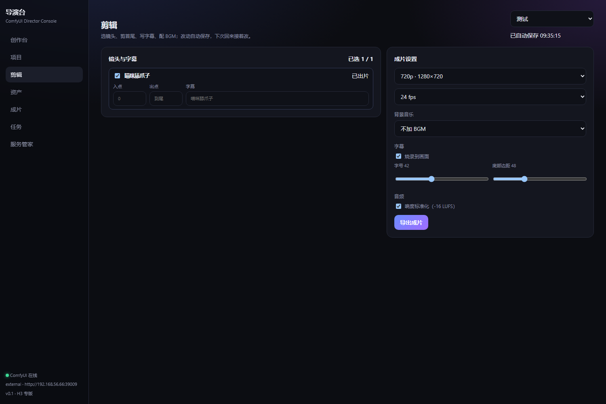
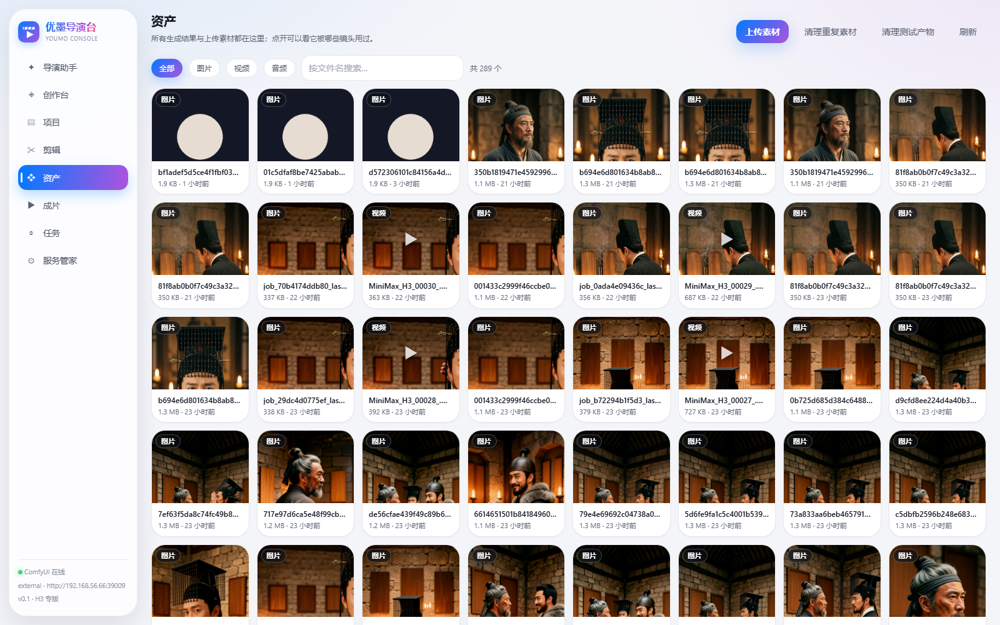
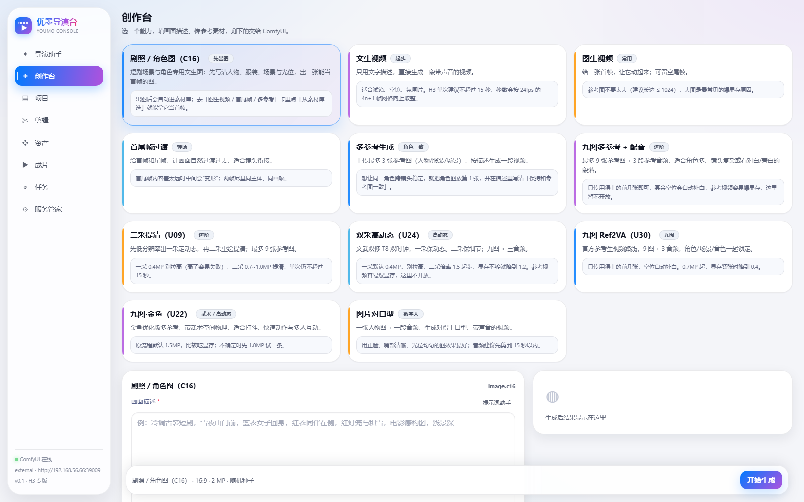

# ComfyUI 导演台

面向内容创作者的 AI 视频工作台：**选一个能力 → 传素材、写描述 → 出片**。
底层仍然是 ComfyUI 在工作流里跑，但创作者永远不需要看到节点。

- 后端：Python 3.11 + FastAPI（`backend/`）
- 前端：React 18 + TypeScript + Vite（`web/`）
- 工作流：47 套 `API-*.json` 全部入库，其中 11 套已配成能力卡（H3 全系）
- 数据：SQLite（`data/director.db`）+ 本地文件（`data/uploads`、`data/outputs`）


## 云端 ComfyUI（推荐）

ComfyUI 不必在本机。打开「服务管家 → ComfyUI 连接」：

1. 连接方式选 **云端 / 外部**（不启动进程）；
2. 填地址，例如 `https://xxxx-8188.proxy.runpod.net`（不带 `http://` 也能识别，不要带 `/api`）；
3. 有鉴权就填令牌（裸 token 当 `Bearer`，`user:password` 自动转 `Basic`）；
4. 点 **测试连接**，看到 GPU/版本/延迟就说明通了；
5. **保存并应用**，立即生效并写入 SQLite，重启后仍然有效。

对应接口：

```bash
GET    /api/settings/comfy        # 当前生效的连接
PUT    /api/settings/comfy        # {mode, base_url, token}
POST   /api/settings/comfy/test   # {base_url, token} 只测试不保存
DELETE /api/settings/comfy        # 回到 config.yaml 默认
```

优先级：**页面里保存的值 > config.yaml > 内置默认**。想回到配置文件，点「恢复配置文件默认」。

> 如果云端地址要走公司代理，把 `config.yaml` 的 `comfy.trust_env` 改成 `true`；
> 本机/局域网直连建议保持 `false`（默认），避免系统代理配置异常导致连不上。

### 没有云端也能先跑通：本地假服务

```bash
python tools/stub_comfy.py --port 8199 --token secret123
```

然后在页面里连 `http://127.0.0.1:8199`、令牌 `secret123`，整条链路（上传/提交/轮询/下载）
都会走真实 HTTP，只是产物是占位文件。用来验证远程接入、鉴权、失败重试很方便。

## 路线图

- [x] M0 服务管家：一键启停 / 状态 / 日志 / 释放显存
- [x] M1 单镜生成：6 张能力卡 + 上传 + 任务队列 + 产物预览
- [x] M1.5 能力卡扩充到 11 张（新增 U00 提示词台 / U09 二采 / U24 双采 / U30 / U22）
- [x] M2 项目与分镜：项目 → 镜头表 → 镜间资产复用（末帧接首帧）
- [x] M2.5 云端 ComfyUI：页面填地址/令牌，测试连接 + 持久化
- [x] M3 成片：镜头勾选排序、逐段标准化、拼接、抽封面（需要本机有 ffmpeg）
- [x] M4 剪辑 M1：逐镜裁剪、BGM 混音、字幕烧录、响度标准化
- [ ] M4 真实环境联调：local / ssh 模式接上 GPU 机

## 提示词助手（可选）

在 `config.local.yaml` 里放密钥（**该文件已 gitignore，不会提交**）：

```yaml
ai:
  api_key: "sk-..."
  proxy: "http://10.0.0.1:8080"   # 只有需要走公司代理时才填
```

`config.yaml` 里配接口与模型：

```yaml
ai:
  base_url: https://www.autodl.art/api/v1
  api_key: ""
  model: "DeepSeek-V4.1-Flash"
  trust_env: false   # 只有想直接用系统 HTTP_PROXY 时才改 true
```

- 改完**保存即生效**：后端按文件修改时间自动重载 `config.yaml` / `config.local.yaml`，不用重启；
- 生成过程走 **SSE 流式返回**，界面实时显示，结束自动填进描述框
- 模型返回的是 JSON，前端会转成 H3 习惯的六段式文本
  （`subject_definitions` / `summary` / `retention_analysis` / `detailed_description` / `overall_soundscape` / `non_diegetic_music`）再填进描述框；
- 没配 key 时按钮仍可点，会提示去哪里配。

## 模型检查

「服务管家 → 模型检查」可以一键检查所有能力卡依赖的模型是否存在于当前连接的 ComfyUI：

- 后端读取每张卡的工作流，抽出 `unet_name` / `clip_name` / `vae_name` / `lora_name` 等字段里的模型文件；
- 调 ComfyUI `/object_info` 拿实际可用模型清单，按“相对路径或文件名”比对；
- 缺失的列出文件名、所在目录类别、可复制的下载命令，以及 HuggingFace 搜索链接。

命令用 curl，支持断点续传和限速：

```bash
curl -L -C - --limit-rate 50m --create-dirs \
  "https://huggingface.co/Comfy-Org/MiniMax-H3/resolve/main/vae/minimax_h3_video_vae_fp16.safetensors" \
  -o "models/vae/minimax_h3_video_vae_fp16.safetensors"
```

配置：

```yaml
models:
  comfy_root: ""                 # 留空 -> models/<category>/<file>；填 ComfyUI 则为 ComfyUI/models/...
  limit_rate: "50m"              # 传给 curl --limit-rate，留空不限速
  download_base: ""              # 没有已知 URL 时的拼接基地址
```

> `mock` 模式没有真实模型清单，检查会直接提示“请配置真实 ComfyUI 地址”。


### 找不到时的搜索入口

每个未解析的模型后面都有三个搜索链接：**HuggingFace / ModelScope / Civitai**，
按文件名（含中文名）带上 query，直接打开就能搜。HF 上找不到的社区权重，
优先去 ModelScope 或 Civitai 搜同名文件。

### 手工补链接

检查结果里每个模型都有「填写链接 / 编辑链接」：粘贴 HF 或任意 HTTP 直链保存后，
会立即重算下载命令，并写入 `data/model-sources.json`（不覆盖随包的
`content/model-sources.json`，下次同步也不会丢）。

接口：

```bash
PUT /api/models/sources   # {name, url, directory}  url 传空字符串表示删除这条手工映射
```

### 随包模型清单

从靶机（全量 ComfyUI）同步后，导出两份随仓库发版的文件：

- `content/model-sources.json`：文件名 → 下载地址（含目录），部署时直接可用；
- `content/model-manifest.json`：能力卡依赖的 36 个模型，带 url / 分类 / 引用卡片。

运行时会**合并** `content/model-sources.json` 与 `data/model-sources.json`（后者是
面板里同步得到的，优先级更高）。所以新部署不需要再连靶机。

> 当前 36 个依赖已全部解析到公开地址（均已 Range 请求校验 206/200）；
> 个别上游文件名与工作流不一致时，下载命令会用 `-o` 落到工作流期望的文件名；
> `content/model-sources.json`。

### 真实下载链接来自 UI 工作流

ComfyUI 面板的「缺失模型 → 下载」按钮，读的是 **UI 工作流 JSON 里节点的
`properties.models`**（`name` / `url` / `directory` / `hash`），并且只对
`civitai.com`、`huggingface.co` 白名单地址展示下载按钮。API 格式工作流没有
`properties`，所以只有 UI workflow 才带仓库信息。

导演台的做法：

1. 连上装有这些工作流的 ComfyUI，点 **「从 ComfyUI 同步模型链接」**：
   后端会从 `/userdata?dir=workflows` 拉取所有 UI 工作流，解析 `properties.models`，
   存到 `data/model-sources.json`（文件名 → 下载地址 / 目录）；
2. 之后再跑模型检查，缺失模型如果命中映射，会直接给出**真实地址**的下载命令，
   并在条目上标「链接来自工作流」；
3. 也可以手动导入：`POST /api/models/sources/import`，body 传单个 UI workflow、
   数组或 `{workflows:[...]}`。

注意：ComfyUI 自身的模型清单接口是 `/experiment/models`（旧代码曾误写为 `/models`），
现已修正。

## 创作台 ↔ 项目

两边现在互通了：

- **创作台 → 保存为镜头**：试出满意的一条后，点当前任务下方的「保存为镜头…」，
  选项目、填标题即可。会把 `preset_id + 全部参数` 写成新镜头，把这次 job 归属回填，
  并自动抽末帧挂到该镜头（所以下一镜能直接用它当首帧）。
- **项目 → 在创作台打开**：镜头编辑器里点「在创作台打开」，会把该镜头的参数带进创作台，
  顶部出现提示条；改完点「保存回该镜头」覆盖，或「返回项目」放弃。

对应接口：

```bash
POST /api/jobs/{job_id}/save-as-shot   # {project_id, title}
GET  /api/shots/{shot_id}              # 带 values / last_frame_url
```


## 成片记录

「成片」是一个独立页签，汇总所有项目的导出记录：

- 状态：草稿 / 排队 / 准备 / 导出中 / 完成 / 失败
- 完成的可下载、预览、取 `.srt`
- **失败的可以「继续导出」**（同一份参数与逐镜编辑直接重跑）
- 「做了一半」的状态由剪辑页自动保存（`/api/projects/{id}/edit-state`），不占成片记录
- 记录存 `renders` 表，服务重启后仍在

剪辑页的参数属于项目本身，存在 `settings` 表的 `edit_state.<project_id>`，换浏览器/重启都还在。

## 资产本地上传

资产页右上角「上传素材」支持多选，自动按扩展名归类：

```
mp4/mov/webm/mkv/avi → 视频
mp3/wav/m4a/aac/flac  → 音频
其余                  → 图片
```

上传后直接进素材库，可被镜头当首帧/参考图，也能当 BGM。

## 提示词助手配置

「服务管家 → 提示词助手」可以在页面上改：

- Base URL（OpenAI 兼容接口）
- 模型名
- API Key（留空表示不修改）
- 代理（可选）

保存后立即生效（覆盖 `config.yaml` / `config.local.yaml` 的值），并写入数据库；
「恢复默认」会删掉库里的覆盖值，回到配置文件。



## 剪辑页（独立工作台）

「剪辑」是独立页签，不再挤在项目页里：

- 顶部可切换项目；从项目页点「去剪辑」会带着项目跳过来；
- 左栏镜头与字幕、右栏成片设置；
- **改动自动保存**（每项目一份，800ms 防抖写库），下次打开继续改；
- 导出后跳到「成片」页看进度和记录。

### 逐镜编辑

- 勾选要导出的镜头（默认全选），顺序由项目镜头列表决定；
- 每个镜头可填 **入点 / 出点**（秒，留空表示从头/到尾）；
- **字幕**留空则自动用镜头标题，导出时按镜长生成时间轴。

### 全局设置

| 项 | 说明 |
|---|---|
| 画布 | 480p / 720p / 1080p，24 / 30 fps |
| 背景音乐 | 从素材库选音频，可调音量（dB）、淡入、淡出、循环铺满 |
| 字幕 | 烧录开关、字号、底部边距；ffmpeg 不支持时自动降级为 `.srt` 旁挂 |
| 音频 | 响度标准化到 -16 LUFS |

### 后台流水线

```
逐镜处理（裁剪/缩放/补边/帧率/音量）
  → 拼接（concat demuxer）
  → 混入 BGM（atrim + afade + amix，循环铺满）
  → 烧录字幕（libass，相对路径 + cwd）
  → 响度标准化（loudnorm）
  → 抽封面 + 写 subtitles.srt
```

进度分阶段写入 `renders.message/progress`，页面实时刷新。

### 产物与接口

- 成片 `data/renders/<id>/final.mp4`，封面 `cover.jpg`，字幕 `subtitles.srt`
- `GET /api/renders/{id}/subtitles` 下载 SRT
- 逐镜参数存 `render_shots` 表（Alembic `0005_render_shots`），属于“这一次成片”，不回写镜头
- `GET /api/ffmpeg/status` 返回 `capabilities`（subtitles / xfade / libx264），前端据此提示降级

### ffmpeg

`install.py` 优先下载 **full 版**（BtbN GPL，含 libass/xfade/libx264），下载失败回退
`imageio-ffmpeg`；两者都会做能力自检。手动安装时也可以直接配：

```yaml
ffmpeg:
  path: ""        # 留空依次找 config → PATH → tools/ffmpeg → imageio-ffmpeg
  crf: "20"
  preset: "medium"
```



## 项目 / 分镜怎么用

1. 「项目」页新建一部片子（例如 `雪夜短片`）。
2. 「加一镜」，选能力卡、填描述、传参考图，点「生成本镜」。
3. 生成成功后，后端会把这条片子的**末帧**抽出来存成素材；下一镜在编辑器顶部点
   **用上一镜末帧**，它就变成了下一镜的首帧（选「图生视频 / 首尾帧」卡时出现）。
4. 每个镜头保留最近 12 次尝试，可回看、可对比。

> 末帧抽取依赖 **ffmpeg**。没装时不会报错，会写入一张「末帧占位」图并在按钮上标「（占位）」，
> 装上 ffmpeg 后自动变成真实末帧。

## 节点包（director-node-pack.zip）

**定位**：这是「ComfyUI 插件包」——任何需要额外放进官方 ComfyUI 的东西（custom_nodes、
节点专用脚本/资源）都收在这里，保证一份 ComfyUI + 这个包就能跑全部能力卡。

> 当前**尚未发布**到 GitHub Release（仓库还在 Gitee，GitHub 镜像未建）。
> 现在部署用 `python install.py --from-comfy <已有ComfyUI>` 或 `--node-pack <本地zip>`；
> `content/node-pack.json` 的 `urls` 留空，等 GitHub Release 建好再填。

已知盲区：只通过「注册枚举值」生效的包（如 **RES4LYF** 提供 `res_2s_ode` 等采样器）
不会被节点类扫描命中，目前不在包里；工作流用到时会自动降级到 `res_multistep`。
后续会补「枚举值 → 来源包」的扫描。


zip 不进 git（224 MB，且 Gitee 单文件限 100 MB）。分发方式：

```
GitHub Release 附件  →  content/node-pack.json 记录 URL + sha256
```

### 清单

`content/node-pack.json`：

```json
{
  "version": "2026.10.20",
  "bytes": 235051308,
  "sha256": "4d8d…",
  "urls": [
    "https://github.com/<owner>/<repo>/releases/download/nodes-2026.10.20/director-node-pack.zip",
    "https://ghfast.top/https://github.com/<owner>/<repo>/releases/download/nodes-2026.10.20/director-node-pack.zip"
  ],
  "packs": { "seedvr2_videoupscaler": {"nodes": ["SeedVR2VideoUpscaler"]} }
}
```

`urls` 可多条，`install.py` 按顺序尝试，**下完校验 sha256**，不匹配自动换下一个。

### 安装

```bash
python install.py --nodes auto            # 本地有 zip 就用，没有就按清单下载
python install.py --nodes local           # 只用本地 zip（内网）
python install.py --nodes download        # 强制下载
python install.py --from-comfy /root/ComfyUI   # 从已有环境复制 26 个目录（完全离线）
```

### 发布新版本

```bash
python tools/pack_nodes.py --comfy D:/workspaces/minimax/ComfyUI
# → 生成 director-node-pack.zip，自动更新 manifest 的 sha256/bytes/version
# → 上传到 GitHub Release（tag 如 nodes-2026.10.20）
# → 把下载地址填进 content/node-pack.json 的 urls
# → 提交 manifest
```

### 打包注意

zip 内路径必须是 `/`。Windows 的 `Compress-Archive` 会写反斜杠，Linux 的 `unzip` 会直接失败；
`tools/pack_nodes.py` 用 `zipfile` 写入，天然是正斜杠。

### 内网

没有外网时用 `--from-comfy`，直接从现成的 ComfyUI 复制节点目录，不下载任何东西。

## 一键安装（install.py）

把裸机变成「面板 + ComfyUI」可用环境：

```bash
python install.py --dry-run                       # 先看会做什么
python install.py \
  --comfy-dir /root/ComfyUI \
  --models-dir /root/autodl-tmp/models \
  --torch cu130 \
  --proxy http://127.0.0.1:1081 \
  --pip-mirror https://pypi.tuna.tsinghua.edu.cn/simple
```

- 面板与 ComfyUI **各自一个 venv**，面板不装 torch；
- ComfyUI 固定 `v0.39.0`，`custom_nodes` 来自 `director-node-pack.zip`
  （地址已填在 `content/node-pack.json`，没有本地 zip 就直接下 GitHub Release）；
- 每步成功写入 `.install-state.json`，可重复执行；`--force` 全部重跑；
- `--skip-comfy` 只装面板，`--comfy-only` 只装 ComfyUI；
- 模型目录支持软链接（AutoDL 系统盘小，放 `/root/autodl-tmp`）；
- `--proxy` 同时给 pip 和文件下载用；`--pip-mirror` 给所有 pip 步骤换源。

### 节点依赖是怎么装的

每个节点包自己带的 `requirements*.txt` / `pyproject.toml` 就是清单，**按包分别装**，不再有一份手写列表：

- 装之前先用 `pip freeze` 把基座包（torch / numpy / scipy / transformers / pillow / huggingface-hub …）
  钉成 `logs/node-deps-constraints.txt`，节点清单想降级它们会被 pip 挡下来，记成「跳过」而不是装坏；
- 整包安装失败会退化成逐个装，一个包的问题不会让整个安装中断；
- 重依赖默认不装：`--with-heavy` 装 demucs / whisper / voxcpm / clip-interrogator / modelscope，
  `--with-build` 装要编译的 llama-cpp-python / xformers / bitsandbytes / insightface；
- 最后统一 cv2（只留 `opencv-contrib-python-headless` 一个构建，并断言 `cv2.dnn.DictValue` 存在），
  避免多个 opencv 包混装导致的 `AttributeError`；
- 装完跑一次 ComfyUI 自己的导入自检（`main.py --quick-test-for-ci --cpu`），
  哪些节点包起不来会直接列出来；`--skip-node-check` 可跳过；
- 详情写 `logs/node-deps-report.txt`，导入自检的完整输出写 `logs/comfy-import-check.log`。

装完执行 `./start-all.sh`（Windows 为 `start-all.bat`），面板在 6006。

## 快速开始

### 1. 后端

默认使用**系统 Python**（当前开发环境为 `D:\Python\Python311\python.exe`，3.11.9）：

```bash
cd backend
python -m pip install -r requirements.txt
python -m uvicorn app.main:app --host 127.0.0.1 --port 6006
```

Windows 也可以直接双击根目录的 `start.bat`；Linux 用 `bash start.sh`。
两个脚本都调用 PATH 里的 `python` / `python3`，也可以用环境变量 `PYTHON` 指定解释器。

> 想用独立虚拟环境：`python -m venv backend/.venv` 后装依赖，再用
> `PYTHON=backend/.venv/Scripts/python.exe` 启动 `start.bat`。
> 仓库里可能残留一个只有 pip 的空 `backend/.venv`，不用时可直接删掉。

### 2. 前端

```bash
cd web
npm install
npm run dev      # 开发模式，http://127.0.0.1:5273（已代理 /api 到 6006）
npm run build    # 生产模式，构建后由后端在 6006 直接托管
```

### 3. 配置 ComfyUI

编辑根目录 `config.yaml`：

```yaml
comfy:
  mode: mock     # 先看界面：mock 不需要显卡
  # mode: local  # 本机一键启停
  # mode: ssh    # 远程 Linux 机一键启停
```

| 模式 | 说明 |
|---|---|
| `mock` | 假装有 ComfyUI，3 秒返回占位产物，用来验证整条链路和界面 |
| `local` | 本机 spawn 子进程；`workdir` 指向 ComfyUI 目录，`python` 指向解释器 |
| `ssh` | 远程机执行 `start` / `stop` 命令，健康检查走 `base_url`（需先打通隧道） |
| `external` | ComfyUI 已由别人托管，只做健康检查与提交 |

本机示例：

```yaml
comfy:
  mode: local
  base_url: http://127.0.0.1:8188
  local:
    workdir: D:/ComfyUI_windows_portable/ComfyUI
    python: D:/ComfyUI_windows_portable/python_embeded/python.exe
    args: ["main.py", "--listen", "127.0.0.1", "--port", "8188"]
```

### 「关闭」关的是哪个进程

- 面板启动 ComfyUI 时会把 pid 记到 `data/comfy-process.json`，后端重启（含 `--reload`）后还能认领回来；
- 如果这个 ComfyUI 不是面板启动的（桌面版、命令行、旧面板开的），点「关闭」会按 `comfy.local_url`
  的端口找到监听进程，确认进程名像 python / ComfyUI 才会结束它，并在提示里说明；
- 进程已经不在了就明确回「ComfyUI 已经没有在运行」，不会再出现「点了没反应」；
- 关掉之后 `data/comfy-process.json` 自动清理，pid 被系统复用时也不会认错进程。

## 现在能做什么

- **服务管家**：一键启动 / 关闭 / 重启 / 释放显存 / 看日志 / 自动健康检查
- **创作台**：11 张能力卡
  | 卡片 | 工作流 | 说明 |
  |---|---|---|
  | 剧照 / 角色图 | C16 | 先出角色/场景图 |
  | 文生视频 | U03 加速 | 只用文字 |
  | 提示词台 | U00 | 只出六段式文本 |
  | 图生视频 | U02 | 一张首帧 |
  | 首尾帧过渡 | U02 | 首帧 + 尾帧 |
  | 多参考生成 | U01 | 最多 3 图 |
  | 九图多参考 + 配音 | U06V9 | 9 图 + 3 音频 |
  | 二采提清 | U09 | 一采草稿 + 二采提清 |
  | 双采高动态 | U24 | T8 双时钟，武术/打斗 |
  | 九图 Ref2VA | U30 | 官方参考路线 |
  | 九图·金鱼 | U22 | 武术空间物理 |
  | 图片对口型 | U11 | 图 + 音频 |

  图片产物会自动进素材库：出完图后到图生视频/首尾帧/多参考卡里点「从素材库选」，
  就能把这张图当首帧/参考图。

  

  表单只暴露创作者关心的字段：描述、画幅、时长、素材
- **任务**：排队、进度、取消、重试、产物预览与下载；支持视频/图片/音频/纯文本四类产物
- **提示词助手**：复用镜像的 4 套 H3 系统提示，把一句话扩写成六段式分镜词
  （需要 `ai.api_key`，OpenAI 兼容接口）

## 镜头顺序

镜头顺序是**项目级唯一数据**：项目左侧镜头列表和「成片导出」里的 ↑↓ 改的是同一份
`shots.idx`，两边实时一致并持久化（`POST /api/projects/{id}/shots/reorder`）。
成片导出按当前镜头顺序取选中的镜头，不再有单独的“导出顺序”。

## 资产 → 项目

资产详情面板里的「加入项目」可以把已有资产直接变成镜头：

| 操作 | 行为 |
|---|---|
| **还原为镜头** | 找到产出它的任务，用**同一 preset + 同一份参数**新建镜头；视频会自动抽末帧 |
| **用作首帧** | 新建一个图生视频镜头，把这张图设为 `first_frame` |
| **用作参考音频** | 新建多参考镜头，把它设为 `audio_1` |

创建完可直接「去该镜头」跳转（`?tab=projects&project=…&shot=…`）。

资产页还提供「清理测试产物」，删除早期 `mock_`/`stub_` 开头的极小文件。

## 资产面板

「资产」页统一管理三类产物：

- 图片 / 视频 / 音频分栏筛选、按文件名搜索、分页加载；
- 点开看大图/播放、大小、尺寸、创建时间，可下载或删除；
- **被哪些镜头使用**：列出项目 + 镜头 + 字段，点一下直接跳到该镜头（`?tab=projects&project=…&shot=…`）；
- 来源任务也一并列出，方便追溯。

生成任务现在会把图片/视频/音频**全部登记为资产**；旧任务用
`POST /api/assets/backfill` 补登记。

在项目镜头里，素材槽位的「库」按钮会按字段类型过滤（图片槽只列图片、音频槽只列音频），
选中的资产直接作为该镜头的输入。



## 界面（2026-10 更新）

- **素材托盘**：图片/音频槽位横向排列、带序号，点击上传、右上角删除、右下角「库」从素材库选；
- **左右分栏**：左边表单、右边当前任务与结果，宽屏并排、窄屏堆叠；
- **底部生成条**：固定显示当前卡的画幅/时长/种子摘要 + 「开始生成」，长表单不用滚到底；
- 支持 `?card=h3.i2v` 直接打开指定能力卡。



## 数据库与迁移（Alembic）

表结构由 Alembic 管理，**不再有手写 CREATE TABLE / ALTER**。

- 迁移脚本：`backend/alembic/versions/`
- 应用启动时自动执行 `upgrade head`（`app/migrate.py`）
- 老库兼容：检测到业务表但没有 `alembic_version` 时，先按现有列判定基线 `stamp`，再升级，不丢数据
- 数据库地址：默认 `data/director.db`；可用环境变量 `DIRECTOR_DB_URL` 覆盖（如 `sqlite:///D:/tmp/test.db`）

常用命令（在 `backend/` 下）：

```bash
# 升级到最新
alembic -c alembic.ini upgrade head

# 查看当前版本 / 历史
alembic -c alembic.ini current
alembic -c alembic.ini history --verbose

# 回退一步
alembic -c alembic.ini downgrade -1

# 新增迁移（改完模型/表结构后）
alembic -c alembic.ini revision -m "add shot duration"
```

SQLite 改表必须走 batch 模式，`env.py` 已全局开启 `render_as_batch=True`，写迁移时用：

```python
with op.batch_alter_table("shots") as batch:
    batch.add_column(sa.Column("duration", sa.Float(), server_default="0"))
```

## 加一张能力卡

在 `presets/` 新建 YAML，把 ComfyUI「API 格式」工作流放到 `workflows/`：

```yaml
id: h3.my_flow
name: 我的新能力
desc: 一句话说明
workflow: API-xxx.json
order: 70
fields:
  - key: prompt
    bind: "139:prompt"        # 节点ID:字段名
    type: textarea
    label: 画面描述
    required: true
  - key: size
    type: size
    mode: wh
    width: "120:自定义宽"
    height: "120:自定义高"
```

字段类型：`text` / `textarea` / `image` / `video` / `audio` / `size` / `duration` / `number` / `select`。
`size` 支持两种模式：`wh`（直接写宽高）和 `aspect_mp`（写画幅 + 兆像素，由 ComfyUI 侧换算）。

## 目录

```
backend/app/
  main.py      FastAPI 路由
  launcher.py  服务管家（local / ssh / external / mock）
  comfy.py     ComfyUI HTTP 客户端 + mock
  ffmpeg.py    ffmpeg 探测 / 标准化 / 拼接 / 抽封面
  render.py    成片导出任务执行器
  presets.py   能力卡加载、参数注入
  jobs.py      任务执行器
  store.py     SQLite
presets/       能力卡（创作者界面）
workflows/     执行用 API 工作流（来自镜像）
content/       提示词系统、参考规范、空白占位素材
data/          SQLite / 上传 / 产物 / ComfyUI 日志
```

## 与旧面板的关系

旧 `zealman-app` 面板保持不动，作为「高级模式」：需要在画布上改节点时跳转过去。
导演台只做两件事：**管住 ComfyUI 进程**、**把工作流包装成人话界面**。

## 已知边界

- 只支持 API 格式工作流；画布里的 UI JSON 不能直接提交
- `mock` 模式产物是占位文件，不是真视频
- 单机单用户，没有账号体系；多机并发是下一阶段

## 许可证

本项目代码采用 **Apache License 2.0**，全文见 [LICENSE](LICENSE)，第三方与来源声明见 [NOTICE](NOTICE)。

需要注意：`workflows/` 与 `content/` 里的工作流、提示词、占位素材来自 Zealman ComfyUI 镜像，
**不在 Apache-2.0 授权范围内**，版权归原作者（该镜像声明「禁止基于本镜像二次开发后发布」）。
对外发布前请替换这些素材或取得授权。

## 安全提醒

- 访问令牌以明文存在本地 `data/director.db` 的 `settings` 表里，只适合单人/内网使用；
  不要把 `data/` 提交到仓库或打包分享。
- 面板默认只监听 `127.0.0.1`。要给别人用，请在前面加一层带鉴权的反向代理（Nginx/Caddy）。
