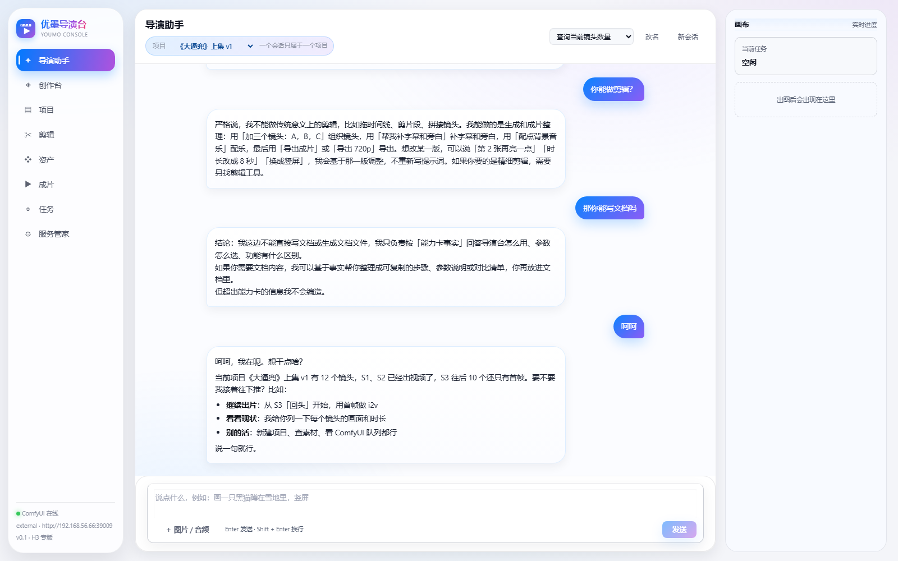

# 导演台使用教程

> 面向第一次上手的人。跟着做完第 1~5 章，你就能独立做出一支带字幕和配乐的成片。
> 全程不需要打开 ComfyUI 的节点界面。

---

## 0. 它是什么

一句话：**把 ComfyUI 的工作流包装成「选卡片 → 填描述 → 出片」的工作台。**

| 你会用到的 | 作用 |
|---|---|
| 创作台 | 选一张能力卡，出单张图 / 单段视频 |
| 项目 | 把镜头排成一条片子，管顺序、管素材 |
| 剪辑 | 逐镜裁剪、字幕、配乐、片头片尾、导出成片 |
| 资产 | 所有生成结果和上传素材的仓库 |
| 导演助手 | 用说话的方式让它帮你做上面这些事 |
| 服务管家 | 连 ComfyUI、看状态、管模型、配 AI |

界面长这样：


---

## 1. 启动

### 1.1 装依赖（只做一次）

```bash
cd backend
python -m pip install -r requirements.txt

cd ../web
npm install
npm run build      # 构建前端，构建产物由后端托管
```

### 1.2 起服务

```bash
cd backend
python -m uvicorn app.main:app --host 127.0.0.1 --port 6006
```

浏览器打开 <http://127.0.0.1:6006>。Windows 也可以直接双击根目录 `start.bat`。

> 开发前端时改用 `cd web && npm run dev`（5273 端口，自动代理 `/api` 到 6006），改样式会热更新。

---

## 2. 连上 ComfyUI

打开左侧 **服务管家 → ComfyUI 连接**。


### 2.1 两种连接方式

| 方式 | 什么时候用 | 你需要填 |
|---|---|---|
| **云端 / 外部** | ComfyUI 跑在云主机 / 局域网另一台机器 / 别人已经启动好了 | 地址（+ 可选令牌） |
| **本机** | ComfyUI 就在这台电脑上，想让面板帮你启停 | `config.yaml` 里的 `workdir` 和 `python` |

### 2.2 填地址的规矩

- 只填**根地址**：`http://192.168.1.20:8188` 或 `https://xxxx-8188.proxy.runpod.net`
- 不要带 `/api`、不要带 `/view`
- 不带 `http://` 也能识别
- 有鉴权就填令牌：裸 token 会当 `Bearer`，`user:password` 会自动转 `Basic`

### 2.3 测试 → 保存

1. 点 **测试连接**，能显示 GPU 型号、显存、版本、延迟 = 通了
2. 点 **保存并应用**，立即生效，重启后还在
3. 想回到 `config.yaml` 的配置，点 **恢复配置文件默认**

> **连不上怎么办？**
> 先确认地址在浏览器里能打开（`http://<地址>/queue` 返回 JSON）。
> 若走公司代理，把 `config.yaml` 里的 `comfy.trust_env` 设成 `true`；
> 局域网直连保持 `false`（默认），否则会被代理劫持成 504。

---

## 3. 第一次出图（5 分钟）

打开 **创作台**，默认选中「剧照 / 角色图（C16）」。


### 3.1 写画面描述

最省事的方式是点右侧 **提示词助手**，用一句人话说你要什么：

```
冷调古装短剧，雪夜山门前，蓝衣女子回头，红灯笼在侧，电影感
```

它会扩写成完整的画面描述（主体 + 服装 + 环境 + 光位 + 镜头）。不满意就改几个词再生成。

### 3.2 参数怎么选

| 参数 | 建议 |
|---|---|
| 画幅 | 竖屏短剧选 **竖屏 9:16**；横屏选 16:9 |
| 清晰度 | 先 0.8~1.0 MP 试；满意了再 2 MP 重出 |
| 随机种子 | 留 `-1` 每次都不一样；想复现某一版就填回那个数字 |

### 3.2.5 改图（手里已经有图）

选中 **改图 / 图生图（Qwen 2.1 编辑）**：

| 槽位 | 说明 |
|---|---|
| 要改的图 | 底图，必需 |
| 参考图 2 / 3 | 可选，比如「把图 2 的人物放到图 1 里」 |
| 改什么 | 一句话指令，例如「把背景换成雪夜山门，保留人物的脸和服装」 |
| 分辨率 | 短边 1024 / 1152 / 1328，越大越慢越吃显存 |

写指令的诀窍是**说清「改什么」+「保留什么」**：模型默认想重画整张图，
点名保留脸、发型、服装、构图，它才不会把人换了。

> **改图 vs 导演助手的「revise」**
> · 改图卡：你**指定参考图**，按指令改这一张
> · revise：改的是**最近那一版产物**，说「再亮一点」「换竖屏」就行

### 3.3 生成与查看

点右下角 **开始生成**。任务会出现在「任务」页，也能在创作台右侧直接看结果。

- 出图一般 30~60 秒
- 出完自动进 **资产**，不用手动保存
- 想存成镜头：任务下方 **保存为镜头…**

> **图生图 / 改图**：现在没有独立的「改图」卡，改画面用「重出一版 + 改提示词」，
> 或者用 **导演助手** 说「第 2 张再亮一点」（走 revise）。

---

## 4. 建项目，把镜头排起来

打开 **项目**。


### 4.1 建项目 → 加镜头

1. 左侧输入项目名（例：`《大逼兜》上集`）→ **新建**
2. 中间 **加一镜**，填标题（可留空自动编号）
3. 选能力卡（图生视频 / 多参考 / 九图…）
4. 右边填参数，点 **生成本镜**

### 4.2 两种填充镜头的方式

| 方式 | 操作 |
|---|---|
| 从零生成 | 在项目右侧直接生成，产物自动挂到这一镜 |
| 从已有产物 | 创作台出完 → **保存为镜头…** → 选项目、填标题 |

### 4.3 末帧接首帧（连续镜头必用）

每一镜出完视频后，会自动抽出**末帧**挂在镜头上。
做下一镜时点「从素材库选」，直接拿上一镜的末帧当首帧——画面就能接得上。

> 顺序也要管：镜头列表的 ↑↓ 改的是项目级顺序，剪辑页和导出用的都是这一份。

---

## 5. 出视频：怎么选卡

这是最容易选错的一步。

| 你的情况 | 用哪张卡 |
|---|---|
| 手里有图，要按指令改（换背景/换衣/加元素） | **改图 / 图生图**（image.ref） |
| 只有文字，没有图 | **文生视频**（t2v） |
| 有一张满意的图，想让它动 | **图生视频**（i2v）——最稳、最可控 |
| 有首帧也有尾帧，要过渡 | **首尾帧过渡**（flf2v） |
| 要锁住人物长相（跨镜头一致） | **多参考生成**（r2v，≤3 图）或 **九图 Ref2VA**（u30） |
| 多人同框 + 对白 | **九图多参考 + 配音**（r2v9） |
| 打斗 / 快动作 / 接触力道 | **九图·金鱼**（u22） |
| 先看动态再提画质 | **二采提清**（u09） |
| 高动态 + 保细节 | **双采高动态**（u24） |
| 一张人像 + 一段音频 | **图片对口型**（lipsync） |

### 5.1 时长会被「取整」

H3 只接受 `4n+1` 帧（24fps）。你填 5 秒 → 实际 121 帧 ≈ 5.04 秒；填 6 秒 → 158 帧 ≈ 6.58 秒。
**单段上限 15 秒**，想更长就拆成多镜。

### 5.2 对白怎么写

在描述里用 `(S1)` 标说话人，用 `<d>[Chinese] 台词</d>` 包住台词：

```
(S1) the son says, <d>[Chinese] 爹。</d>
(S2) the father answers, <d>[Chinese] 嗯。</d>
```

> 每镜最多两句，说多了会糊。

---

## 6. 剪辑与出成片

打开 **剪辑**，选项目。


### 6.1 勾选与排序

- 时间轴上的镜头按项目顺序排，勾选决定哪些进成片
- 点某一镜 → 下方展开该镜的逐项设置

### 6.2 逐镜设置

| 项 | 说明 |
|---|---|
| 入点 / 出点 | 裁剪这一段（留空 = 用到结尾） |
| 速度 | 0.5x ~ 2.0x |
| 适配 | 画面比例不一致时补边 / 裁切 / 模糊 |
| 字幕文案 | 这一镜要烧的字幕；**留空会烧镜头名**，不想要字幕就勾「无旁白文案」 |
| 旁白 / 口播 | 两套独立系统：旁白=解说音轨，口播=对上口型 |

### 6.3 全局设置（右侧）

- **分辨率**：竖屏 480p / 720p / 1080p，横屏同样三档；选项目画幅对应的那一档
- **画布适配**：补边（保留全画面，可能有黑边）/ 裁切 / 模糊
- **转场**：直接切 / 交叉溶解
- **片头片尾**：给成片加标题卡
- **背景音乐**：从素材库挑，音量以 dB 计（-20 ≈ 10%），可设淡入淡出和循环
- **字幕**：字号、底部边距、语言
- **响度标准化**：默认开，输出 -16 LUFS，适合平台播放

### 6.4 导出

点右上 **导出成片**，完成后到 **成片** 页下载。

产物：

```
data/renders/<id>/final.mp4     成片
data/renders/<id>/cover.jpg     封面
data/renders/<id>/subtitles.srt 字幕文件
```

> 导出依赖本机 `ffmpeg`。服务管家页能看到 ffmpeg 是否就绪；
> 没有的话装系统 ffmpeg，或用 `imageio-ffmpeg`。

<details>
<summary><b>进阶：视频自带字幕（不要再烧一遍）</b></summary>

有些视频卡（九图多参考 + 配音、图片对口型）生成时**已经带了硬字幕或人声**。
再让剪辑烧一遍会叠字，这时候开这个开关：

- 项目级默认：**成片设置 → 字幕 → 视频自带字幕**
- 单镜覆盖：该镜的「自带字幕」选 `是` / `否` / `跟随全局`

勾「是」之后，这一镜**不生成字幕、也不烧录**，成片只做裁剪、拼接、转场和音频混合。

> 判断方法：把这一段单独播一次，画面里已经有字 = 开；没有 = 保持跟随全局。
</details>

<details>
<summary><b>进阶：多轨 BGM（铺底 + 高潮 + 结尾）</b></summary>

「成片设置 → 背景音乐」最多可以放 **4 条**音乐，每条独立设置：

| 参数 | 说明 |
|---|---|
| 音量 | 以 dB 计，-20 ≈ 10%，-14 ≈ 20% |
| 起止 | 相对**正片**的时间（0 = 片头结束后），可只铺某一段 |
| 淡入 / 淡出 | 秒；交叉处靠它做衔接 |
| 循环 | 区间比音乐长时自动循环铺满 |

允许时间重叠——两条重叠时就是交叉淡入淡出。

另外两个自动行为：

- 勾 **旁白出现时自动压低 BGM**，会把「BGM 总线」整体压一次（不是每条各自压），旁白结束再回来
- 结尾有**限幅**，防止叠加后爆音

不想手动排：在 **AI 剪辑**弹层里选一个背景音乐，它会自动铺满正片、淡入 1 秒淡出 2 秒、
有旁白取 -18 dB / 没有旁白取 -12 dB，并自动打开压低开关——之后再手动微调。
</details>

---

## 7. 导演助手：用说话的方式做片

打开 **导演助手**，选一个项目（一个会话只属于一个项目），然后直接说。



### 7.1 它能听懂什么

```
画一张雪夜剑客，竖屏
用刚才那张图做一个 5 秒的视频
第 2 镜重做，颜色太艳了
帮我给这条片子补字幕和旁白
配点紧张的音乐
导出成片
```

### 7.2 确认门：每一步都要你点

它不会直接开跑。每个关键动作（出图、出视频、导出、配乐…）都会弹一张**确认卡**，
上面写着参数和预估耗时，你点「确认」才执行。

- 多步任务想先试第一步：点 **只执行第一步**
- 不想执行：点 **取消**，它会回一句「已取消，这次没有提交」
- 做错了：说 **「撤销」/「回退」**，会退到上一版产物

### 7.3 它知道工作台的真实状态

| 你可以问 | 它会查 |
|---|---|
| ComfyUI 现在通吗 | 现探一次接口，报在线状态、地址、延迟、队列 |
| 我做过多少项目 | 项目清单 + 每项镜头数 + 最近导出状态 |
| 这个项目什么进度 | 镜头数 / 已有首帧 / 已出视频 / 总时长 / 导出次数 |
| 素材库里有什么猫的图 | 按类型 + 关键词检索 |
| 这个镜头用什么参数 | 查能力卡字段 |

### 7.4 两个小技巧

- 说清楚**做什么、多长、什么画幅**，比「做个视频」有效得多
- 手里有图时问「这张接下来怎么弄」，它会给你 2~3 个可执行方案再让你选

---

## 8. 资产管理与清理

打开 **资产**。


- 顶部按类型筛（全部 / 图片 / 视频 / 音频），可按文件名搜
- 卡片左上角标类型，点开看详情：被哪些镜头用过、下载、加入项目
- **清理重复素材**：同一文件被登记多次时合并
- **清理测试产物**：删掉早期 `stub_` 开头的极小文件

> 上传素材支持图片 / 视频 / 音频；音频会自动识别时长，可当 BGM 或口播音轨。

---

## 9. 常见问题

**Q：服务管家提示「连不上 ComfyUI」**
浏览器打开 `http://<地址>/queue` 看是否返回 JSON。打不开 = 网络/地址问题；
能打开但面板报错 = 令牌或 `trust_env` 配置问题。

**Q：提示词助手报 504 / 一大段 HTML**
模型地址被代理劫持了。局域网地址不该走代理；检查 `config.yaml` 里 `ai.proxy` 是否被设成了公司代理。

**Q：生成的视频里出现多只手 / 多条腿**
提示词里没有限制数量。加一句「画面里只有一只手 / 只出现两个人」，并用 i2v 从干净的首帧出发。

**Q：跨镜头人物长相不一致**
纯文生图每跑一次都是新脸。要么用**多参考 / 九图**卡带角色锚点，要么先做一张角色锚点图，
后续都拿它当参考。

**Q：字幕位置出现镜头名**
字幕文案留空时会用镜头标题兜底。不想要字幕就勾「无旁白文案」，或者填上真正的字幕。

**Q：导出比例不对 / 有黑边**
镜头素材比例和导出分辨率不一致。把「画布适配」改成裁切（会切掉边缘）或保持补边（可能有黑边）。

**Q：显存不够 / 任务失败**
换更小的档位：r2v9/u22 从 0.7 MP 降到 0.4；二采类卡片一采别拉高。

**Q：任务一直排队**
服务管家看 ComfyUI 队列；多人共用一台 GPU 时会排队，等或让管理员加机器。

**Q：改了配置没生效**
页面里保存的值优先级最高（存在 SQLite）。点「恢复配置文件默认」再改。

---

## 10. 一个完整例子：3 镜头小片

```
1. 创作台 → C16 出角色锚点（16:9 / 1 MP），存成「主角」
2. 项目 → 新建《试拍》→ 加 3 镜，每镜用「图生视频」
   · 第 1 镜：首帧 = 主角锚点，5 秒
   · 第 2 镜：首帧 = 第 1 镜末帧，5 秒
   · 第 3 镜：首帧 = 第 2 镜末帧，4 秒
3. 剪辑 → 勾 3 镜 → 字幕填台词 → 加一段 BGM（-20 dB）→ 导出成片
4. 成片页下载 final.mp4
```

或者更省事：在导演助手说一句
「用《试拍》这个项目，做一个 3 镜头的雪地武打小片，每镜 5 秒，最后导出」，
然后一路点确认。

---

## 附：接口速查

```bash
GET    /api/settings/comfy          # 当前连接
PUT    /api/settings/comfy          # {mode, base_url, token}
POST   /api/settings/comfy/test     # 只测试不保存
GET    /api/presets                 # 11 张能力卡
POST   /api/jobs                    # 提交生成任务
GET    /api/jobs/{id}               # 查任务状态/产物
GET    /api/projects                # 项目列表
POST   /api/projects/{id}/renders   # 建导出草稿
POST   /api/renders/{id}/start      # 开始合成
```
